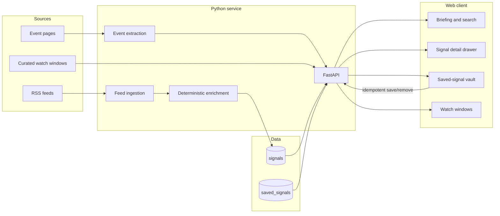
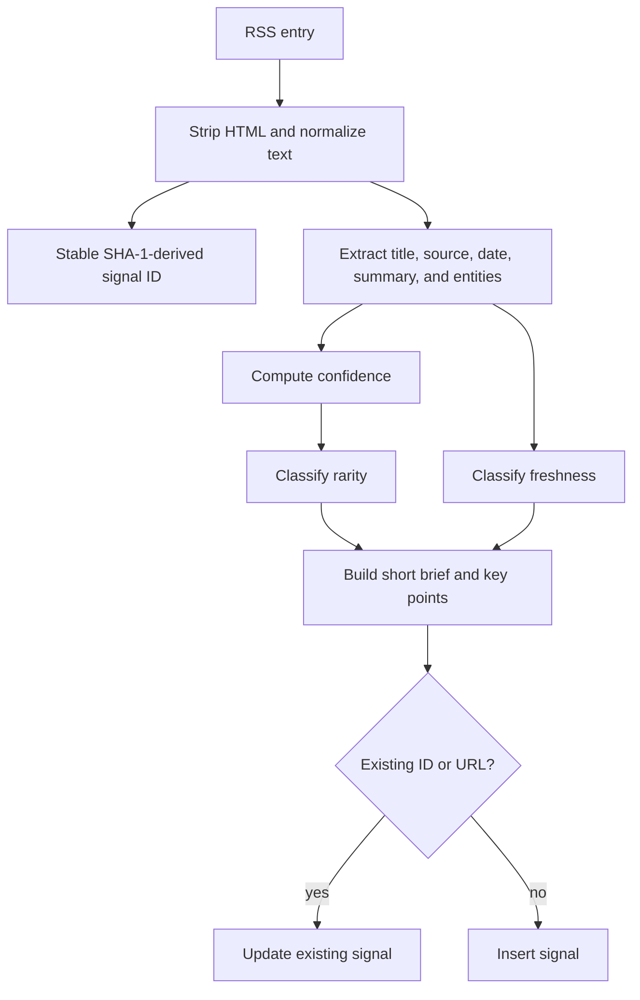
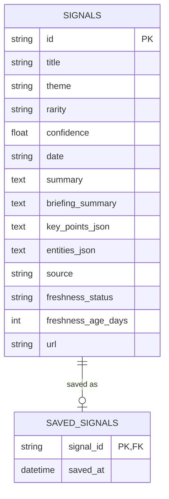

# Luxury Briefing

A full-stack briefing workspace that turns luxury-market feeds and event calendars into a searchable, ranked review queue.

[](https://github.com/rishabhlakra/luxury-briefing/actions/workflows/ci.yml)

Development started as a local prototype in February 2026. I published the repository in October 2026 and kept the original local commit history, so the commits predate the GitHub repository creation date.

## Why I built it

Luxury reporting arrives as a mix of launches, transactions, campaigns, auctions, and design coverage. Reading every source is slow; a flat feed makes the important items hard to separate from routine coverage. I built Luxury Briefing to collect that material in one place, add transparent prioritisation signals, and support a faster review workflow without pretending that a rule-based score can predict the market.

## Product flow

1. **Briefing** — browse normalized signals, search the corpus, filter by theme, and sort by date, confidence, or rarity.
2. **Signal drawer** — review a compact brief with key points, entities, source context, freshness, and the original article.
3. **Vault** — save and remove signals without duplicating records.
4. **Watch Windows** — combine scraped event listings with curated dates for auctions, art fairs, design weeks, and industry events.
5. **Theme controls** — switch between light and dark interfaces; the preference persists in the browser.

The interface is organized around three editorial lenses—Hidden Moves, Wealth Radar, and Concierge Edge—while the API keeps the underlying search and ranking behavior explicit.

## System design



The local stack runs as three containers: PostgreSQL, a FastAPI service, and a Vite-powered React client. SQLAlchemy owns persistence, while Docker Compose provides the service wiring and a persistent database volume.

## Ingestion and enrichment

The feed pipeline is intentionally deterministic. It does not call an external language model, so the same article produces the same ID, score, classification, and generated brief.



### Confidence model

Confidence is a bounded weighted score built from observable article properties:

| Component | Weight | What it measures |
|---|---:|---|
| Signal strength | 26% | Presence of high-signal terms minus common roundup noise |
| Recency | 24% | Age of the source item |
| Title specificity | 20% | Concrete, concise titles with useful detail |
| Source trust | 18% | Configured prior for the publisher |
| Summary quality | 12% | Amount of usable source text |

A stable hash-derived adjustment prevents every item with similar features from collapsing to the same displayed score. Final values are clamped between `0.32` and `0.95`. The score is a triage aid, not a probability or investment signal.

### Rarity and freshness

- **Rarity** combines the confidence band with explicit markers such as `record`, `first`, `exclusive`, `limited-edition`, and `private sale`.
- **Freshness** is `fresh` through day 3, `recent` through day 14, `aging` through day 30, and `stale` thereafter.
- **Briefs** are assembled from extracted entities, theme-specific impact language, score context, and source age.
- **Deduplication** checks both the stable signal ID and source URL; repeated ingestion updates the stored record rather than creating another copy.

## Data model



The saved-signal table is deliberately small: it records membership in the vault without copying article data. Save and remove operations are idempotent, so repeated requests leave the same final state.

## API

| Method | Route | Purpose |
|---|---|---|
| `GET` | `/health` | Service health check |
| `GET` | `/themes` | Distinct themes available for filtering |
| `GET` | `/signals` | Search, filter, and sort signals |
| `GET` | `/saved` | Return the saved-signal vault |
| `POST` | `/save/{signal_id}` | Add a signal to the vault |
| `DELETE` | `/save/{signal_id}` | Remove a signal from the vault |
| `POST` | `/ingest` | Fetch and upsert the configured RSS feeds |
| `GET` | `/events?days=90` | Extract events inside a date horizon |
| `GET` | `/events/curated` | Return the maintained watch-window list |

`GET /signals` accepts `theme`, `q`, and `sort` query parameters. Search covers titles, summaries, briefing text, and extracted entities. Sorting supports newest-first, confidence, and an explicit `Rare → Uncommon → Common` order.

## Run locally

### Docker Compose

```bash
git clone https://github.com/rishabhlakra/luxury-briefing.git
cd luxury-briefing
docker compose up --build
```

Open `http://127.0.0.1:5173`. The API runs on `http://127.0.0.1:8000`, and PostgreSQL is exposed on port `5432`.

### Run the services separately

Start PostgreSQL:

```bash
docker compose up -d db
```

Start the API:

```bash
cd backend
python3 -m venv .venv
source .venv/bin/activate
pip install -r requirements.txt
uvicorn main:app --reload --host 127.0.0.1 --port 8000
```

Start the web client in another terminal:

```bash
cd frontend
npm ci
npm run dev
```

Set `VITE_API_BASE` if the API is not available at `http://127.0.0.1:8000`. Set `CORS_ORIGINS` as a comma-separated list when the frontend is served from another origin.

## Repository map

```text
backend/
  main.py               API routes and signal serialization
  ingest.py             RSS normalization, scoring, enrichment, and upserts
  events_scrape.py      JSON-LD and fallback event extraction
  curated_windows.py    Maintained event watch windows
  models.py             SQLAlchemy models
frontend/
  src/App.tsx           Briefing, vault, events, search, and detail workflow
  src/App.css           Responsive light/dark product styling
.github/workflows/
  ci.yml                Frontend and backend checks
docker-compose.yml      Local database, API, and web stack
THIRD_PARTY_NOTICES.md  Attribution for the adapted GlassSurface component
```

## Checks

Every push and pull request runs:

- `npm ci`, ESLint, and the TypeScript/Vite production build for the frontend
- dependency installation and Python bytecode compilation for the backend

Run the same frontend checks locally with:

```bash
cd frontend
npm run lint
npm run build
```

## Deliberate limits

- Confidence and rarity are hand-built editorial heuristics; they have not been calibrated against labeled market outcomes.
- The vault currently represents one local demo user. Authentication and per-user ownership are not implemented.
- Event extraction depends on third-party page structure and falls back from JSON-LD to link-based parsing when structured data is unavailable.
- Feed coverage is only as complete as the configured RSS sources, and source quality varies.
- Schema additions are applied at startup for this small project; a migration tool would be the next step before multi-environment deployment.

These limits are kept visible because the project is a working decision-support prototype, not a claim of automated market intelligence.
